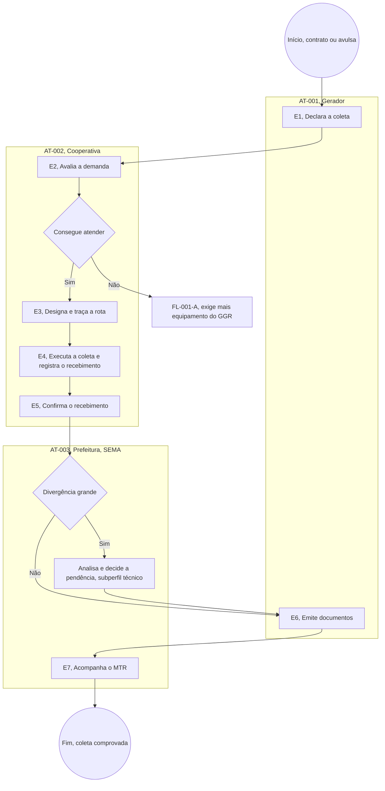

Atores do macrofluxo: [AT-001, Gerador](<01 - Atores e Perfis.md>), AT-002, Cooperativa, e AT-003, Prefeitura (SEMA), com os subperfis Painel de gestão e Técnico/administrativo da regulação.

## Evento inicial e evento de encerramento

Evento inicial: chegada da data ou da ocorrência prevista em contrato entre Gerador e Cooperativa, ou surgimento da necessidade de uma coleta avulsa, fora do contrato.

Evento de encerramento: coleta com recebimento confirmado, documentos emitidos e MTR visível para a Prefeitura por demanda e contrato. Quando há divergência grande, o encerramento só ocorre após a decisão do subperfil técnico da Prefeitura sobre a pendência (FL-001-E01).

## Fluxo principal, FL-001

Representação textual: necessidade de coleta (contrato ou avulsa), AT-001 declara a coleta, AT-002 avalia se consegue atender, AT-002 designa e traça a rota, AT-002 executa a coleta e registra o recebimento, AT-002 confirma o recebimento, AT-001 emite os documentos, AT-003 acompanha o MTR. Resultado: coleta comprovada e situação regulatória atualizada.

Detalhamento por etapa:

| Etapa | Ator | Ação | Entrada | Regra ou validação | Saída | Próxima etapa |
|---|---|---|---|---|---|---|
| E1, Declaração da coleta | AT-001 | Declara a coleta prevista em contrato ou avulsa, informa a quantidade em litros | Contrato vigente ou necessidade avulsa | RN-006 | Demanda registrada | E2 |
| E2, Avaliação da demanda | AT-002 | Analisa se consegue atender a demanda | Demanda declarada | Decisão: atende ou não | Demanda aceita ou não aceita | E3, ou FL-001-A se não aceita |
| E3, Designação e rota | AT-002 | Designa quem executa a coleta e traça a rota | Demanda aceita | RN-017, localização, horário, dia, capacidade do caminhão | Rota definida | E4 |
| E4, Coleta e registro | AT-002 | Executa a coleta, registra que recebeu e a que horas | Rota definida | RN-010, registro obrigatório do responsável e do horário | Registro de recebimento | E5 |
| E5, Confirmação do recebimento | AT-002 | Confirma o recebimento da coleta | Registro de recebimento | RN-020 a RN-025, quando aplicável a comparação de medições | Recebimento confirmado, ou pendência | E6, ou FL-001-E01 se houver divergência grande |
| E6, Emissão de documentos | AT-001 | Emite MTR, QR de regularização, PGRS e comprovante | Recebimento confirmado | RN-002 | Documentos emitidos | E7 |
| E7, Acompanhamento pela Prefeitura | AT-003, subperfil técnico | Visualiza o MTR por demanda e por contrato | Documentos emitidos | RN-001 | Situação atualizada no painel da Prefeitura | Encerramento |

## Fluxos alternativos

**FL-001-A, demanda não atendida**: em E2, a Cooperativa (AT-002) avalia e conclui que não consegue atender a demanda do Gerador (AT-001). O cadastro desse GGR junto à Prefeitura (AT-003) passa a exigir que a cooperativa disponibilize mais equipamento (RN-008). A demanda permanece sem designação até nova avaliação; o fluxo não segue para E3 enquanto isso não for resolvido.

**FL-001-B, situação regulatória em paralelo**: a qualquer momento, de forma independente do ciclo de uma coleta específica, a situação regulatória do estabelecimento (Regular, Irregular ou Pendente) é recalculada pela Prefeitura (AT-003) a partir do cadastro, do PGRS e das demandas do GGR (RN-036 a RN-039). Este fluxo roda em paralelo ao fluxo principal e pode alterar a situação do GGR antes, durante ou depois de uma coleta.

## Exceções

**FL-001-E01, divergência de medição grande**: em E5, a variação entre a quantidade declarada pelo Gerador, a observada na coleta e a aferida no recebimento ultrapassa a tolerância configurada (RN-022). Gera-se uma pendência para análise do subperfil técnico da Prefeitura (AT-003), que decide com justificativa registrada (RN-024 e RN-025). O fluxo principal só retoma para E6 após essa decisão.

**FL-001-E02, coleta prevista não executada**: a coleta prevista na recorrência do contrato não é executada dentro do prazo combinado. Gera-se uma pendência de execução. Quando a causa é atribuída à Cooperativa, RN-041 exige justificativa registrada em até 96 horas e a remarcação da coleta.

**FL-001-E03, PGRS vencido ou próximo do vencimento**: independentemente do ciclo de coleta em curso, o PGRS do Gerador completa 12 meses (RN-003) e a situação passa a exibir o estado "a renovar" (RN-033, hoje com 30 dias de antecedência, valor configurável) ou, se não regularizado, Irregular (RN-036). Isso não interrompe uma coleta já em andamento.

## Pontos de decisão

- Cooperativa consegue atender a demanda? Sim: segue para E3, designação e rota. Não: segue para FL-001-A, exigência de mais equipamento junto à Prefeitura.
- Há divergência de medição grande entre o declarado, o observado e o aferido? Sim: segue para FL-001-E01, pendência para análise do subperfil técnico da Prefeitura. Não: segue para E6, emissão de documentos.
- A coleta prevista foi executada dentro do prazo combinado em contrato? Sim: segue o fluxo principal normalmente. Não: segue para FL-001-E02, pendência de execução.
- O PGRS do Gerador está dentro da validade? Sim: o Gerador pode seguir declarando coletas normalmente. Não: segue para FL-001-E03, estado a renovar ou Irregular.

## Representação resumida (BPMN)

Cada subgrafo é uma raia por ator; os losangos são os pontos de decisão B2 e C1; o caminho reto de cima é o fluxo principal FL-001; os desvios são FL-001-A e FL-001-E01. FL-001-B, FL-001-E02 e FL-001-E03 não estão neste diagrama por rodarem em paralelo ao ciclo de uma coleta específica.

Pontos em aberto ligados a este documento: ver [Contradições e Pontos em Aberto](<Contradições e Pontos em Aberto.md>).
