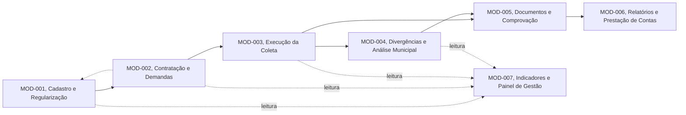

Um módulo representa um conjunto coerente de capacidades do sistema, não uma tela ou página. Uma mesma tela pode servir a mais de um módulo, e um módulo pode se manifestar em várias telas diferentes para cada ator; a distribuição entre telas é uma etapa técnica posterior, fora do escopo deste documento.

Foram identificados sete módulos, cobrindo do cadastro inicial até a leitura consolidada de indicadores: MOD-001, Cadastro e Regularização; MOD-002, Contratação e Demandas; MOD-003, Execução da Coleta; MOD-004, Divergências e Análise Municipal; MOD-005, Documentos e Comprovação; MOD-006, Relatórios e Prestação de Contas; MOD-007, Indicadores e Painel de Gestão.

## MOD-001, Cadastro e Regularização

Objetivo: manter os cadastros de grandes geradores e cooperativas atualizados e calcular a situação regulatória de cada estabelecimento.

Descrição: reúne os dados cadastrais do GGR e da cooperativa, o PGRS e seu vencimento, e os parâmetros que a Prefeitura define para o município, produzindo a classificação Regular, Irregular ou Pendente.

- Atores envolvidos: AT-001, mantém seu cadastro e o PGRS; AT-002, mantém seu cadastro; AT-003, subperfil técnico, cadastra GGR e cooperativas, define parâmetros do município e classifica a situação regulatória.
- Funcionalidades: manter cadastro do GGR (CNPJ, endereço, razão social, responsável técnico, contrato vigente); enviar e renovar o PGRS; cadastrar grandes geradores e cooperativas, pela Prefeitura; definir parâmetros do município; calcular e exibir a situação regulatória do estabelecimento.
- Entradas: dados cadastrais informados pelo GGR e pela cooperativa; data de emissão do PGRS; parâmetros definidos pela Prefeitura; classificação manual de inconformidade grave, quando aplicável.
- Processamentos: verificar completude do cadastro; verificar o vencimento do PGRS (12 meses) e a antecedência do alerta "a renovar"; combinar cadastro, PGRS e demandas para classificar a situação regulatória.
- Saídas: cadastro atualizado; estado do PGRS (válido, a renovar ou vencido); situação regulatória do estabelecimento (Regular, Irregular ou Pendente).
- Dependências: recebe de MOD-002 o histórico de demandas do GGR, usado para compor a situação regulatória.
- Integrações relacionadas: SUL (INT-002), troca confirmada dos cadastros autodeclaratórios do GGR.
- Regras relacionadas: RN-002, RN-003, RN-004, RN-005, RN-033, RN-036, RN-037, RN-038, RN-039.

## MOD-002, Contratação e Demandas

Objetivo: registrar a declaração de coletas pelo Gerador e permitir que a cooperativa avalie o que consegue atender antes de assumir a rota.

Descrição: cobre a etapa inicial da cadeia, da declaração de uma coleta prevista em contrato ou avulsa até a decisão da cooperativa de aceitar ou não a demanda.

- Atores envolvidos: AT-001, declara a coleta; AT-002, avalia a demanda.
- Funcionalidades: declarar coleta prevista em contrato; declarar coleta avulsa, fora do contrato; declarar a quantidade de resíduo, em litros; avaliar quais demandas a cooperativa consegue atender.
- Entradas: contrato vigente entre GGR e cooperativa, com dias da semana e quantidade de coletas definidos; necessidade de coleta avulsa; quantidade declarada.
- Processamentos: verificar se a demanda está prevista em contrato ou é avulsa; registrar a decisão da cooperativa sobre a demanda.
- Saídas: demanda registrada; demanda aceita ou não aceita.
- Dependências: depende de MOD-001 para o cadastro do GGR e o contrato estarem em ordem; alimenta MOD-003 com as demandas aceitas.
- Integrações relacionadas: nenhuma.
- Regras relacionadas: RN-006, RN-008, RN-016, RN-018, RN-019; RN-034, reclassificada para o domínio da demanda e da execução.

## MOD-003, Execução da Coleta

Objetivo: designar quem executa a coleta, otimizar a rota, realizar a coleta em campo e confirmar o recebimento.

Descrição: cobre a designação da rota, a execução física da coleta, o controle de quem entrega a carga na unidade e a confirmação do recebimento, incluindo a gestão da equipe de cooperados.

- Atores envolvidos: AT-002, em todas as ações; a execução em campo é feita por pessoas vinculadas à cooperativa, sob o mesmo perfil (ver [01 - Atores e Perfis](<01 - Atores e Perfis.md>)).
- Funcionalidades: designar quem executa a coleta; traçar e sugerir a rota otimizada; registrar o recebimento e o horário da coleta; registrar foto ou quantidade e tipo do resíduo, quando viável; conferir a entrada e saída de quem entrega a carga; gerir a equipe de cooperados; manter a identificação dos cooperados no programa municipal de coleta seletiva; registrar justificativa e remarcar a coleta não executada por causa atribuída à cooperativa, em até 96 horas (RN-041).
- Entradas: demanda aceita, vinda de MOD-002; localização, horário, dia da semana e capacidade do caminhão; registro de quem executa a coleta.
- Processamentos: calcular a rota considerando localização, horário, dia e capacidade; validar que todo recebimento tem responsável e horário registrados.
- Saídas: rota definida; registro de recebimento; recebimento confirmado; eventualmente massa aferida e tíquete de pesagem, no papel de unidade receptora.
- Dependências: depende de MOD-002 (demanda aceita); alimenta MOD-004 quando há divergência, e MOD-005 quando o recebimento é confirmado sem divergência.
- Integrações relacionadas: nenhuma confirmada.
- Regras relacionadas: RN-009 e RN-017, complementares; RN-010, RN-011, RN-012, RN-013, RN-014, RN-035; RN-041, justificativa e remarcação por falta de execução atribuída à cooperativa.

## MOD-004, Divergências e Análise Municipal

Objetivo: comparar as medições de uma carga e decidir sobre divergências grandes antes de liberar a comprovação.

Descrição: recebe os dados de medição da coleta (declarada, observada e aferida) e, quando a variação ultrapassa a tolerância configurada, abre uma pendência para decisão humana da Prefeitura.

- Atores envolvidos: AT-002, fornece as medições; AT-003, subperfil técnico, decide a pendência.
- Funcionalidades: comparar as três medições de uma carga; verificar se a variação está dentro da tolerância; abrir pendência quando a variação é grande; registrar a decisão da Prefeitura, com justificativa.
- Entradas: quantidade declarada pelo GGR, quantidade observada na coleta, massa aferida no recebimento; tolerância configurada.
- Processamentos: calcular a variação entre as medições; classificar a carga como conciliada ou pendente; registrar o evento de decisão, sem sobrescrever as medições originais.
- Saídas: carga conciliada, liberando o comprovante, ou pendência registrada, aguardando decisão.
- Dependências: depende de MOD-003 (medições da coleta); alimenta MOD-005 quando conciliada.
- Integrações relacionadas: nenhuma confirmada.
- Regras relacionadas: RN-020, RN-021, RN-022, RN-023, RN-024, RN-025.

## MOD-005, Documentos e Comprovação

Objetivo: emitir os documentos que comprovam a regularidade da coleta e dar visibilidade a esses dados para a Prefeitura.

Descrição: a partir do recebimento confirmado e, quando aplicável, da conciliação sem divergência, o Gerador emite seus documentos e a Prefeitura passa a visualizar o MTR por demanda e contrato.

- Atores envolvidos: AT-001, emite; AT-003, subperfil técnico, visualiza.
- Funcionalidades: consultar e vincular o MTR emitido no SINIR (INT-001); emitir QR code de regularização; emitir PGRS; emitir comprovante simplificado; visualizar o MTR por demanda e por contrato aprovado ou finalizado.
- Entradas: recebimento confirmado, vindo de MOD-003; resultado da conciliação, vindo de MOD-004, quando aplicável.
- Processamentos: gerar os documentos a partir do registro confirmado; referenciar a fonte, a data da consulta e o identificador de qualquer dado vindo de um sistema oficial.
- Saídas: MTR, QR de regularização, PGRS, comprovante simplificado; visibilidade do MTR para a Prefeitura.
- Dependências: depende de MOD-003 e, condicionalmente, de MOD-004; alimenta MOD-006.
- Integrações relacionadas: SINIR (INT-001), origem do MTR emitido, consultado pelo sistema; SUL (INT-002), troca confirmada dos cadastros autodeclaratórios do GGR.
- Regras relacionadas: RN-001, RN-002, RN-021, RN-026, RN-027, RN-028.

## MOD-006, Relatórios e Prestação de Contas

Objetivo: permitir que cada ator exporte o que já foi registrado dentro do próprio escopo.

Descrição: cobre a exportação de relatórios de contrato e coletas avulsas do Gerador, do que a unidade recebeu pela cooperativa, e dos processos do município pela Prefeitura.

- Atores envolvidos: AT-001, AT-002, AT-003.
- Funcionalidades: exportar prestação de contas do contrato e das coletas avulsas; exportar o que a unidade recebeu; exportar os processos do município; exportar em .xls e .pdf.
- Entradas: dados já registrados nos módulos anteriores, dentro do escopo de cada ator.
- Processamentos: consolidar os dados do período solicitado; gerar o arquivo de exportação.
- Saídas: relatórios em .xls ou .pdf.
- Dependências: depende de MOD-002, MOD-003 e MOD-005 como fonte de dados.
- Integrações relacionadas: nenhuma.
- Regras relacionadas: RN-007.

## MOD-007, Indicadores e Painel de Gestão

Objetivo: dar a cada ator uma visão consolidada e atual da própria situação, sem repetir o detalhe operacional dos outros módulos.

Descrição: cobre o painel do Gerador (situação do contrato e das coletas em andamento), o painel da cooperativa (o que está a caminho e o que foi recebido) e o painel de gestão da Prefeitura (indicadores do município).

- Atores envolvidos: AT-001, AT-002, AT-003, subperfil Painel de gestão.
- Funcionalidades: exibir a situação do contrato e das coletas em andamento; exibir o que está a caminho e o que foi recebido; exibir indicadores do município.
- Entradas: dados consolidados de MOD-001 a MOD-005, conforme o escopo de cada ator.
- Processamentos: agregar os dados por período e por ator.
- Saídas: indicadores e situação exibidos no painel de cada ator.
- Dependências: depende de todos os módulos anteriores como fonte de leitura; não alimenta nenhum módulo seguinte.
- Integrações relacionadas: SGP digital, possível origem de indicadores do painel da Prefeitura.
- Regras relacionadas: RN-001, parcial, acesso da Prefeitura a indicadores.

## Tabela consolidada de módulos

| ID      | Módulo                           | Objetivo                                                  | Atores                 | Principais funcionalidades                                                            | Dependências                                   |
| ------- | -------------------------------- | --------------------------------------------------------- | ---------------------- | ------------------------------------------------------------------------------------- | ---------------------------------------------- |
| MOD-001 | Cadastro e Regularização         | Manter cadastros em dia e calcular a situação regulatória | AT-001, AT-002, AT-003 | Cadastro do GGR e da cooperativa, PGRS, parâmetros do município, situação regulatória | Recebe de MOD-002                              |
| MOD-002 | Contratação e Demandas           | Declarar e avaliar a coleta                               | AT-001, AT-002         | Declarar coleta, avaliar demanda                                                      | Depende de MOD-001, alimenta MOD-003           |
| MOD-003 | Execução da Coleta               | Designar, coletar e confirmar o recebimento               | AT-002                 | Designar, traçar rota, coletar e registrar, gerir equipe                              | Depende de MOD-002, alimenta MOD-004 e MOD-005 |
| MOD-004 | Divergências e Análise Municipal | Comparar medições e decidir pendências                    | AT-002, AT-003         | Comparar medições, abrir e decidir pendência                                          | Depende de MOD-003, alimenta MOD-005           |
| MOD-005 | Documentos e Comprovação         | Emitir documentos e dar visibilidade à Prefeitura         | AT-001, AT-003         | Emitir MTR, QR, PGRS, comprovante; visualizar MTR                                     | Depende de MOD-003 e MOD-004, alimenta MOD-006 |
| MOD-006 | Relatórios e Prestação de Contas | Exportar o que foi registrado                             | AT-001, AT-002, AT-003 | Exportar relatórios em .xls e .pdf                                                    | Depende de MOD-002, MOD-003 e MOD-005          |
| MOD-007 | Indicadores e Painel de Gestão   | Consolidar a situação de cada ator                        | AT-001, AT-002, AT-003 | Exibir painéis e indicadores                                                          | Depende de todos os módulos anteriores         |

## Mapa de dependência entre módulos

Cadeia principal: MOD-001 (Cadastro e Regularização) → MOD-002 (Contratação e Demandas) → MOD-003 (Execução da Coleta) → MOD-004 (Divergências e Análise Municipal, quando aplicável) → MOD-005 (Documentos e Comprovação) → MOD-006 (Relatórios e Prestação de Contas).

MOD-007 (Indicadores e Painel de Gestão) depende de MOD-001, MOD-002, MOD-003 e MOD-004 em modo de leitura, e não alimenta nenhum módulo seguinte.

A seta pontilhada de MOD-002 para MOD-001 indica que o histórico de demandas realimenta o cálculo da situação regulatória (RN-036 a RN-039); as demais setas pontilhadas indicam leitura de MOD-007 sobre os módulos anteriores, sem retorno.

## Cobertura do macrofluxo por módulo

| Elemento do macrofluxo ([02 - Macrofluxo do Sistema](<02 - Macrofluxo do Sistema.md>)) | Módulo que cobre |
|---|---|
| E1, Declaração da coleta | MOD-002 |
| E2, Avaliação da demanda | MOD-002 |
| E3, Designação e rota | MOD-003 |
| E4, Coleta e registro | MOD-003 |
| E5, Confirmação do recebimento | MOD-003, aciona MOD-004 quando há divergência |
| E6, Emissão de documentos | MOD-005 |
| E7, Acompanhamento pela Prefeitura | MOD-005, leitura também em MOD-007 |
| FL-001-A, demanda não atendida | MOD-002, aciona MOD-001, cadastro do GGR |
| FL-001-B, situação regulatória em paralelo | MOD-001 |
| FL-001-E01, divergência de medição grande | MOD-004 |
| FL-001-E02, coleta prevista não executada | MOD-002 e MOD-003 |
| FL-001-E03, PGRS vencido ou próximo do vencimento | MOD-001 |

Todos os elementos identificados no macrofluxo estão cobertos por pelo menos um módulo.

Pontos em aberto ligados a este documento: ver [Contradições e Pontos em Aberto](<Contradições e Pontos em Aberto.md>).
