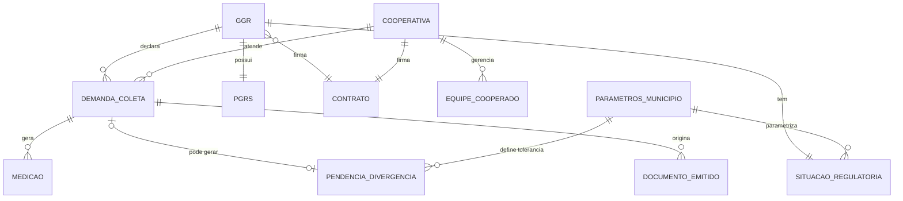

Este documento não inventa API, endpoint, protocolo, formato de arquivo de integração ou disponibilidade de qualquer sistema externo.

## Modelo conceitual das principais entidades de informação

Dez entidades de informação, a partir dos módulos ([03 - Módulos Funcionais](<03 - Módulos Funcionais.md>)) e dos estados ([05 - Estados e Ciclos de Vida](<05 - Estados e Ciclos de Vida.md>)). As quatro já modeladas com ciclo de vida (EST-001 a EST-004) são reaproveitadas integralmente; as demais são entidades cadastrais ou de configuração, sem estado próprio.

Entidades cogitadas e não detalhadas com estado próprio, por ausência de definição de ciclo de vida nas fontes: Contrato, Cadastro da Cooperativa e Equipe ou Cooperado. Aparecem no diagrama como entidades cadastrais, sem os estados que EST-001 a EST-004 têm.

### Detalhamento das entidades

- **GGR, Grande Gerador**. Atributos: CNPJ, endereço, razão social, responsável técnico, contrato vigente. Relações: 1 GGR para muitas Demandas; 1 GGR para 1 PGRS vigente; 1 GGR para 1 Situação regulatória. Rastreabilidade: AT-001, MOD-001, FL-003, RN-004, RF-001.
- **Cooperativa**. Atributos: dados cadastrais da organização; acumula o papel implícito de unidade receptora ([01 - Atores e Perfis](<01 - Atores e Perfis.md>)). Relações: 1 Cooperativa para muitas Demandas atendidas; 1 Cooperativa para muitos cooperados na Equipe. Rastreabilidade: AT-002, MOD-001, FL-006, RF-003.
- **Contrato, entre GGR e Cooperativa**. Atributos: dias da semana e quantidade de coletas previstos; apenas citado como vigente nas fontes. Relações: liga um GGR a uma Cooperativa; origina Demandas previstas em contrato. Rastreabilidade: MOD-002, RN-018, RN-019, RF-006. Sem ciclo de vida definido (ver [05 - Estados e Ciclos de Vida](<05 - Estados e Ciclos de Vida.md>)).
- **PGRS**. Atributos: data de emissão, estado (Válido ou Vencido, EST-003). Relações: 1 GGR para 1 PGRS vigente; alimenta a Situação regulatória. Rastreabilidade: AT-001, MOD-001, FL-003, RN-002, RN-003, RN-033, EST-003, RF-002.
- **Demanda e Coleta**. Atributos: tipo (prevista em contrato ou avulsa), quantidade em litros, estado (EST-001). Relações: 1 GGR declara; 1 Cooperativa atende; gera muitas Medições; pode gerar 1 Pendência de divergência; origina Documentos emitidos. Rastreabilidade: AT-001, AT-002, MOD-002, MOD-003, FL-001, FL-002, FL-004, RN-006, RN-010, EST-001, RF-006 a RF-016, RF-031.
- **Medição, declarada, observada e aferida**. Atributos: três valores por carga (declarada pelo GGR, observada pela Cooperativa na coleta, aferida no recebimento), nunca apagados ou alterados (RN-023). Relações: pertence a uma Demanda e Coleta; alimenta a comparação de MOD-004. Rastreabilidade: AT-001, AT-002, MOD-004, RN-011 a RN-014, RN-020, RN-023, RF-011, RF-012, RF-017.
- **Pendência de Divergência de Medição**. Atributos: estado (Aberta, Decidida liberada ou mantida, EST-004); decisão e justificativa, quando houver. Relações: pertence a uma Demanda e Coleta; depende dos Parâmetros do município para a tolerância. Rastreabilidade: AT-002, AT-003, MOD-004, FL-007, RN-022, RN-024, RN-025, EST-004, RF-018, RF-019, RNF-001, RNF-005.
- **Situação Regulatória do Estabelecimento**. Atributos: estado (Pendente, Regular, A renovar, Irregular, EST-002), calculado, não inserido diretamente por nenhum ator. Relações: pertence a um GGR; depende do PGRS e do histórico de Demandas. Rastreabilidade: AT-001, AT-003, MOD-001, FL-003, RN-033, RN-036 a RN-039, EST-002, RF-005.
- **Equipe de Cooperados**. Atributos: dados do cooperado, identificação no programa municipal de coleta seletiva; o cooperado não é usuário do sistema. Relações: pertence a uma Cooperativa. Rastreabilidade: AT-002, MOD-003, FL-005, RF-015, RF-016.
- **Parâmetros do Município**. Atributos: tolerância de conciliação, antecedência do alerta de renovação do PGRS. Relações: alimenta a Situação regulatória e a Pendência de divergência. Rastreabilidade: AT-003, MOD-001, MOD-004, FL-006, RN-022, RN-033, RF-004.
- **Documento Emitido**. Atributos: tipo (MTR, QR, PGRS emitido ou comprovante); referência à fonte, data da consulta e identificador, quando vindo de sistema oficial (RN-027). Relações: originado por uma Demanda e Coleta concluída; detalhado no catálogo de documentos abaixo. Rastreabilidade: AT-001, AT-003, MOD-005, FL-002, RN-002, RN-027, RF-020 a RF-024.

## Catálogo de documentos

- **DOC-001, MTR (Manifesto de Transporte de Resíduos)**. Documento que comprova o transporte do resíduo coletado, emitido via SINIR. Emissor: AT-001. Visualizador: AT-003, subperfil Técnico. Origem: Demanda e Coleta com recebimento confirmado. Rastreabilidade: MOD-005, FL-002 (passo 5), FL-001 (E6), RN-002, RN-027, RF-020, RF-024. Integração de origem: INT-001, SINIR. Emitido no SINIR, não pelo sistema (decisão D-01); o sistema guarda o vínculo e a referência de origem (RN-027).
- **DOC-002, QR code de regularização**. Código que comprova a regularidade do descarte. Emissor: AT-001. Origem: Demanda e Coleta com recebimento confirmado. Rastreabilidade: MOD-005, FL-002 (passo 5), RN-002, RF-021. Integração de origem: nenhuma confirmada. Composição (decisão D-06): situação regulatória do GGR, responsável técnico, última coleta e PGRS, este último apenas quando não for documento particular.
- **DOC-003, PGRS, documento emitido**. Documento do Plano de Gerenciamento de Resíduos Sólidos, refletindo o estado vigente da entidade PGRS (EST-003). Emissor: AT-001. Origem: envio ou renovação do PGRS. Rastreabilidade: MOD-001, MOD-005, FL-003 (passo 3), RN-002, RN-003, EST-003, RF-002, RF-022. Integração de origem: nenhuma confirmada.
- **DOC-004, Comprovante simplificado**. Documento com as informações principais do MTR, em formato simplificado. Composição (decisão D-06): responsável técnico, responsável da coleta, horário de entrega da coleta, tipo de resíduo e quantidade. Emissor: AT-001. Origem: DOC-001 já emitido. Rastreabilidade: MOD-005, FL-002 (passo 5), RN-002, RF-023. Integração de origem: nenhuma; deriva do DOC-001.
- **DOC-005, Tiquete de pesagem**. Registro da pesagem da carga, quando a Cooperativa efetivamente pesa o resíduo. Emissor: AT-002, na condição de unidade receptora. Origem: recebimento da carga, quando há pesagem. Rastreabilidade: MOD-003, RN-013, RF-012. Integração de origem: nenhuma confirmada.
- **DOC-006, Contrato entre GGR e Cooperativa**. Instrumento que define dias da semana e quantidade de coletas previstos, e a relação comercial de cobrança direta entre as partes. Partes: AT-001 e AT-002. Origem: fora do sistema, apenas referenciado como vigente. Rastreabilidade: MOD-002, RN-018, RN-019, RF-006. Integração de origem: nenhuma.
- **DOC-007, Relatório exportado**. Relatório de prestação de contas, do que a unidade recebeu, ou dos processos do município, exportado em .xls ou .pdf. Emissores: AT-001, AT-002, AT-003, cada um dentro do próprio escopo. Origem: dados consolidados de MOD-002, MOD-003 e MOD-005. Rastreabilidade: MOD-006, RN-007, RF-025 a RF-027. Integração de origem: nenhuma. Os três relatórios de exportação (Gerador, Cooperativa, Prefeitura) foram tratados como um único documento, por serem a mesma natureza de saída, variando apenas o escopo por ator.

## Catálogo de integrações

- **INT-001, SINIR**. Sistema nacional onde o MTR é emitido pelo Gerador; o sistema consulta o MTR já emitido e o vincula à demanda (DOC-001, decisão D-01). Sentido: entrada, o sistema consulta e consome o MTR emitido no SINIR, não emite documento fiscal. Ator que aciona: AT-001. Rastreabilidade: MOD-005, RN-002, RN-027, RF-020, RNF-006, DOC-001. O sentido funcional está confirmado (decisão D-01).
- **INT-002, SUL (Sistema Único de Licenciamento de Porto Velho)**. Sistema municipal de licenciamento, origem dos cadastros autodeclaratórios do GGR trocados com o sistema (decisão D-04). Sentido: há troca de dados confirmada, com conteúdo dos cadastros autodeclaratórios do GGR. Ator que aciona: AT-003, subperfil Técnico, e AT-001, na medida em que o cadastro autodeclaratório do GGR alimenta MOD-001. Rastreabilidade: [01 - Atores e Perfis](<01 - Atores e Perfis.md>), MOD-001, MOD-005, RN-027. Como o dado é autodeclarado na origem, RNF-002 e RN-028 se aplicam a ele.
- **INT-003, SGP digital**. Possível sistema de origem de indicadores para o painel de gestão da Prefeitura. Sentido: entrada, dados consumidos pelo painel de indicadores. Ator que aciona: AT-003, subperfil Painel de gestão. Rastreabilidade: [01 - Atores e Perfis](<01 - Atores e Perfis.md>), MOD-007, RF-030.

Nenhuma integração adicional foi identificada nas fontes. A Catanorte não é tratada como integração externa: ela é a própria organização representada pelo ator AT-002 no piloto, não um sistema externo que troca dados com o sistema.

## Cobertura

Todos os documentos citados nas saídas de MOD-005 (MTR, QR de regularização, PGRS e comprovante simplificado) receberam um DOC-XXX (DOC-001 a DOC-004). O tiquete de pesagem recebeu DOC-005, com a condicionalidade já registrada. O contrato entre GGR e Cooperativa recebeu DOC-006. Os relatórios de MOD-006 foram agrupados em um único DOC-007. As três integrações citadas em [01 - Atores e Perfis](<01 - Atores e Perfis.md>) e [03 - Módulos Funcionais](<03 - Módulos Funcionais.md>) (SINIR, SUL, SGP digital) receberam um INT-XXX (INT-001 a INT-003).

Nenhuma entidade do modelo conceitual ficou sem pelo menos um documento ou uma integração associada, quando aplicável; Equipe de Cooperados e Parâmetros do Município não originam documento nem integração, por serem puramente internas ao sistema, o que é esperado, não uma lacuna.

Pontos em aberto ligados a este documento: ver [Contradições e Pontos em Aberto](<Contradições e Pontos em Aberto.md>).
