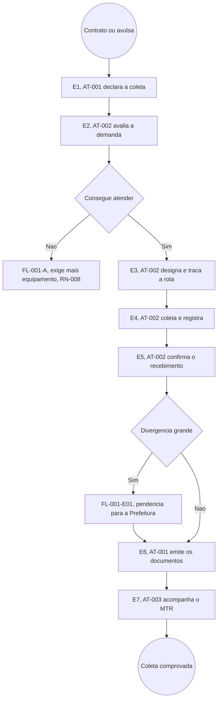
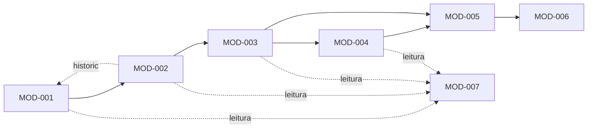
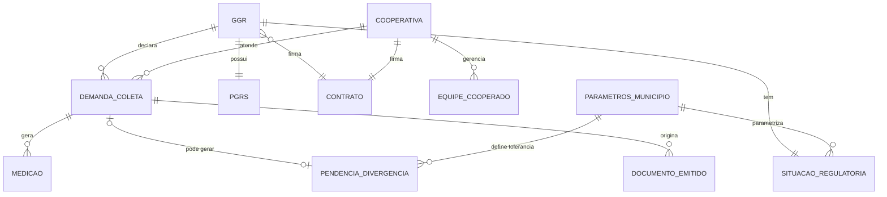
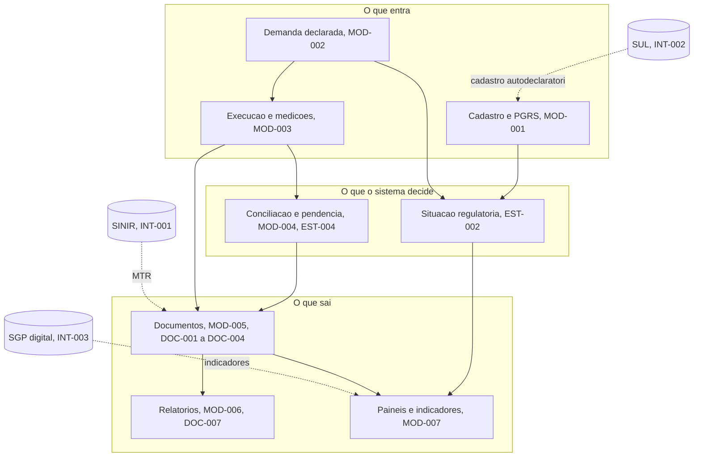

# SAMAÚMA, Sistema de Grandes Geradores e Inclusão Produtiva

Este é o documento central do SAMAÚMA. Foi escrito para que alguém que não participou de nenhuma etapa anterior entenda o produto inteiro sem precisar abrir os documentos auxiliares, e saiba exatamente onde procurar quando quiser o detalhe.

Ele sintetiza, não repete. Cada afirmação aqui carrega o identificador do elemento que a sustenta, e o detalhe completo desse elemento vive no documento indicado na seção de referências cruzadas, ao final.

Convenção de identificadores:

| Prefixo | O que identifica | Onde é detalhado |
|---|---|---|
| `AT-XXX` | Ator ou perfil de acesso | [01 - Atores e Perfis](<01 - Atores e Perfis.md>) |
| `FL-001` | Macrofluxo do sistema | [02 - Macrofluxo do Sistema](<02 - Macrofluxo do Sistema.md>) |
| `MOD-XXX` | Módulo funcional | [03 - Módulos Funcionais](<03 - Módulos Funcionais.md>) |
| `FL-002` a `FL-008` | Fluxo por ator | [04 - Fluxos por Ator](<04 - Fluxos por Ator.md>) |
| `EST-XXX` | Entidade com ciclo de vida | [05 - Estados e Ciclos de Vida](<05 - Estados e Ciclos de Vida.md>) |
| `RN-XXX` | Regra de negócio | [06 - Regras de Negócio](<06 - Regras de Negócio.md>) |
| `RF-XXX`, `RNF-XXX` | Requisito funcional e não funcional | [07 - Catálogo de Requisitos](<07 - Catálogo de Requisitos.md>) |
| `DOC-XXX`, `INT-XXX` | Documento e integração | [09 - Dados, Documentos e Integrações](<09 - Dados, Documentos e Integrações.md>) |

## Contexto

Em Porto Velho, estabelecimentos enquadrados como grandes geradores de resíduos sólidos são obrigados, pelo Decreto Municipal 15.603/2018, a dar destino adequado ao que produzem e a comprovar isso perante a Prefeitura. Na prática, essa comprovação se espalha por papel, planilha e sistemas que não conversam: o gerador guarda um comprovante aqui, a cooperativa anota a coleta ali, e a Prefeitura só descobre o que aconteceu quando pede.

O SAMAÚMA, construído pela LUMMENUS para a Prefeitura de Porto Velho (SEMA), liga as três pontas dessa cadeia em um só registro. O gerador declara a coleta, a cooperativa avalia, executa e confirma o recebimento, e a Prefeitura acompanha o resultado sem redigitar nada. O mesmo fluxo que dá previsibilidade à cooperativa produz a prova documental do gerador e o dado de fiscalização do município.

O nome do sistema carrega a segunda intenção do projeto: inclusão produtiva. A coleta é executada por uma cooperativa de catadores, no piloto a Catanorte, e o sistema registra a equipe de cooperados e sua identificação no programa municipal de coleta seletiva, tornando visível um trabalho que costuma ficar fora de qualquer registro formal.

O que o sistema **é**: um registro compartilhado do ciclo de uma coleta, da declaração à comprovação, com cálculo automático da situação regulatória de cada estabelecimento.

O que o sistema **não é**: não é um sistema de cobrança (RN-018, RN-019); não é um emissor de documento fiscal, o MTR é emitido no SINIR e apenas consultado aqui (decisão D-01); e não é um aplicador de penalidades (RN-031), nem um emissor de selo de regularidade (RN-030). Toda decisão administrativa continua sendo de uma pessoa da Prefeitura (RN-025, RN-037).

## Escopo, premissas, restrições e dependências

### No escopo do piloto

- Cadastro de grandes geradores e cooperativas, e cálculo da situação regulatória de cada estabelecimento (MOD-001).
- Declaração de coletas, previstas em contrato ou avulsas, e avaliação pela cooperativa (MOD-002).
- Designação, rota, execução em campo, registro e confirmação do recebimento, mais gestão da equipe de cooperados e portaria (MOD-003).
- Comparação das medições de uma carga e decisão humana sobre divergências (MOD-004).
- Emissão do QR de regularização, do PGRS e do comprovante simplificado, e consulta do MTR emitido no SINIR (MOD-005).
- Exportação de relatórios por ator, em .xls e .pdf (MOD-006).
- Painéis de acompanhamento por ator e indicadores do município (MOD-007).

### Fora do escopo do piloto

- Rastreamento da destinação do material após o recebimento pela cooperativa (RN-035).
- Perfil individual para o catador autônomo (RN-029). O cooperado atua sob o acesso da Cooperativa.
- Automação de penalidades, multas ou qualquer ato administrativo (RN-031).
- Emissão automática de selo de regularidade, que depende de validação jurídica do município (RN-030).
- Resíduos de serviços de saúde, construção civil, logística reversa especializada e coleta domiciliar comum (RN-032).
- Intermédio da Prefeitura na relação comercial entre gerador e cooperativa (RN-018, RN-019).

### Premissas

- Existe um contrato vigente entre gerador e cooperativa, com dias e quantidade de coletas definidos, que dá origem às coletas recorrentes. O contrato em si não tem ciclo de vida modelado (DOC-006).
- A cooperativa é o único ator operacional da coleta e acumula o papel de unidade receptora (RN-035, decisão registrada em [01 - Atores e Perfis](<01 - Atores e Perfis.md>)).
- O cooperado não é usuário do sistema; a execução em campo ocorre sob o acesso da Cooperativa (RN-029).
- A quantidade de resíduo é declarada em litros (RN-006).

### Restrições

- Decisões administrativas são sempre humanas, nunca automáticas (RN-025, RN-030, RN-031, RN-037, consolidadas em RNF-004).
- As três medições de uma carga não podem ser apagadas ou alteradas para eliminar uma divergência (RN-023, RNF-005).
- Toda alteração relevante preserva valor anterior, novo valor, autor, data, hora e justificativa (RN-026, RNF-001).
- Dado vindo de sistema oficial carrega fonte, data da consulta e identificador de origem (RN-027, RNF-006).
- Quatro perfis de acesso, e apenas quatro (RN-040, RNF-003).

### Dependências externas

- **SINIR** (INT-001): o MTR é emitido lá e consultado pelo sistema (decisão D-01).
- **SUL** (INT-002): troca confirmada dos cadastros autodeclaratórios do GGR (decisão D-04).
- **SGP digital** (INT-003): possível origem dos indicadores do município.
- **Catanorte**: não é integração, é a organização representada por AT-002 no piloto. Algumas regras de operação dependem de confirmação com ela (RN-034).

## Atores e perfis

Três atores, quatro perfis de acesso (RN-040). Nenhum outro papel citado nas fontes (responsável técnico do GGR, operador contratado, catador) tem acesso próprio.

| Perfil | Quem é | O que faz de mais característico | Onde atua |
|---|---|---|---|
| AT-001, Gerador | Estabelecimento enquadrado como grande gerador | Declara a coleta e emite os documentos que comprovam a regularidade | MOD-001, MOD-002, MOD-005, MOD-006, MOD-007 |
| AT-002, Cooperativa | Organização que coleta e transporta; no piloto, a Catanorte; acumula a unidade receptora | Avalia a demanda, designa, coleta, registra e confirma o recebimento | MOD-002, MOD-003, MOD-004, MOD-006, MOD-007 |
| AT-003, subperfil Técnico/administrativo da regulação | Prefeitura, SEMA, lado operacional | Cadastra, parametriza, decide pendências e classifica inconformidade grave | MOD-001, MOD-004, MOD-005, MOD-006, MOD-007 |
| AT-003, subperfil Painel de gestão | Prefeitura, SEMA, lado de apresentação | Vê indicadores do município e exporta relatórios em .pdf e .xls (decisão D-03) | MOD-006, MOD-007 |

Três decisões estruturais sobre atores, mantidas de [01 - Atores e Perfis](<01 - Atores e Perfis.md>):

1. A Cooperativa é um ator único. A pessoa que executa a coleta em campo trabalha sob o perfil da cooperativa, sem login próprio.
2. O papel de unidade receptora fica implícito dentro da Cooperativa (RN-035). Como consequência, duas das três medições de uma carga saem do mesmo perfil, o que reduz a independência da conciliação.
3. A Prefeitura tem dois subperfis com funções distintas.

Cargos internos sem acesso definido: o responsável técnico do GGR, hoje apenas dado cadastral (RN-004), e o operador contratado pela cooperativa, decisão que RN-005 mantém com a Catanorte.

## Macrofluxo

O ciclo começa quando chega a data prevista no contrato, ou quando surge a necessidade de uma coleta avulsa. Termina quando o recebimento está confirmado, os documentos foram emitidos e o MTR está visível para a Prefeitura. Sete etapas, FL-001.

| Etapa | Ator | Ação | Regra | Estado resultante |
|---|---|---|---|---|
| E1 | AT-001 | Declara a coleta e a quantidade em litros | RN-006 | EST-001, Criada |
| E2 | AT-002 | Avalia se consegue atender | RN-008 | EST-001, Aceita ou Não aceita |
| E3 | AT-002 | Designa quem executa e traça a rota | RN-009, RN-017 | EST-001, Em coleta |
| E4 | AT-002 | Executa a coleta e registra responsável e horário | RN-010 | EST-001 |
| E5 | AT-002 | Confirma o recebimento; medições são comparadas | RN-020 a RN-025 | EST-001, Recebida, depois Em conciliação |
| E6 | AT-001 | Emite QR, PGRS e comprovante; vincula o MTR do SINIR | RN-002, RN-027 | EST-001, Comprovada |
| E7 | AT-003 Técnico | Acompanha o MTR por demanda e contrato | RN-001 | Encerramento |

Dois fluxos correm em paralelo ao ciclo de uma coleta específica:

- **FL-001-B**, situação regulatória: a classificação do estabelecimento (EST-002) é recalculada a qualquer momento a partir do cadastro, do PGRS e do histórico de demandas (RN-036 a RN-039).
- **FL-001-E03**, vencimento do PGRS: 30 dias antes do vencimento a situação passa a A renovar (RN-033, decisão D-05); sem renovação até o vencimento, passa a Irregular (RN-036).

Três desvios do caminho principal:

- **FL-001-A**, demanda não atendida: a cooperativa conclui que não consegue atender e o cadastro passa a sinalizar necessidade de mais equipamento (RN-008).
- **FL-001-E01**, divergência de medição grande: a variação entre as três medições ultrapassa a tolerância (RN-022), e abre pendência para decisão humana da Prefeitura (RN-024, RN-025).
- **FL-001-E02**, coleta prevista não executada: quando a causa é atribuída à Cooperativa, ela justifica em até 96 horas e remarca (RN-041).

Detalhe completo: [02 - Macrofluxo do Sistema](<02 - Macrofluxo do Sistema.md>).

## Módulos funcionais

Sete módulos, MOD-001 a MOD-007. Módulo é um conjunto coerente de capacidades, não uma tela: uma tela pode servir a vários módulos, e um módulo aparece em várias telas.

| ID | Módulo | Para que serve | Atores | Requisitos |
|---|---|---|---|---|
| MOD-001 | Cadastro e Regularização | Manter cadastros e PGRS em dia e calcular a situação regulatória | AT-001, AT-002, AT-003 | RF-001 a RF-005 |
| MOD-002 | Contratação e Demandas | Declarar a coleta e avaliar o que a cooperativa consegue atender | AT-001, AT-002 | RF-006 a RF-008 |
| MOD-003 | Execução da Coleta | Designar, traçar rota, coletar, confirmar, gerir equipe e portaria | AT-002 | RF-009 a RF-016, RF-031 |
| MOD-004 | Divergências e Análise Municipal | Comparar medições e decidir pendências | AT-002, AT-003 | RF-017 a RF-019 |
| MOD-005 | Documentos e Comprovação | Emitir e reunir a prova documental da coleta | AT-001, AT-003 | RF-020 a RF-024 |
| MOD-006 | Relatórios e Prestação de Contas | Exportar o que já foi registrado, por escopo de ator | AT-001, AT-002, AT-003 | RF-025 a RF-027 |
| MOD-007 | Indicadores e Painel de Gestão | Dar a cada ator a visão consolidada da própria situação | AT-001, AT-002, AT-003 | RF-028 a RF-030 |

A cadeia principal é linear, com um único retorno: MOD-001 alimenta MOD-002, que alimenta MOD-003, que alimenta MOD-004 quando há divergência e MOD-005 quando não há, e MOD-005 alimenta MOD-006. O retorno é de MOD-002 para MOD-001: o histórico de demandas realimenta o cálculo da situação regulatória (RN-036 a RN-039). MOD-007 apenas lê os demais e não alimenta ninguém.

Detalhe completo: [03 - Módulos Funcionais](<03 - Módulos Funcionais.md>).

## Fluxos detalhados por ator

Sete fluxos por ator desdobram o macrofluxo, FL-002 a FL-008. A numeração continua a de FL-001 para evitar colisão.

| ID | Fluxo | Ator | O que entrega | Exceções |
|---|---|---|---|---|
| FL-002 | Declarar coleta e obter comprovação | AT-001 | Coleta declarada e documentos emitidos | FL-002-A, não atendida; FL-002-E01, divergência; FL-002-E02, cadastro ou PGRS irregular |
| FL-003 | Manter cadastro e regularidade | AT-001 | Cadastro e PGRS em dia, situação calculada | FL-003-A, renovação; FL-003-E01, PGRS vencido; FL-003-E02, inconformidade grave |
| FL-004 | Avaliar, designar e executar a coleta | AT-002 | Recebimento confirmado | FL-004-A, não aceita; FL-004-E01, divergência; FL-004-E02, não executada |
| FL-005 | Gerir equipe e portaria | AT-002 | Equipe identificada e carga conferida | FL-005-E01, pessoa não identificada |
| FL-006 | Cadastrar GGR e cooperativa, definir parâmetros | AT-003 Técnico | Cadastros e parâmetros do município | FL-006-E01, cadastro duplicado |
| FL-007 | Analisar e decidir pendências de divergência | AT-003 Técnico | Pendência decidida com justificativa | FL-007-E01, sem critério objetivo |
| FL-008 | Acompanhar MTR e indicadores | AT-003, ambos os subperfis | MTR e indicadores exibidos, relatórios exportados | Nenhuma |

O caminho feliz, lido de ponta a ponta: o gerador mantém cadastro e PGRS (FL-003) e declara a coleta (FL-002). A cooperativa avalia, designa, executa e confirma (FL-004), com a equipe mantida em FL-005. Se a variação das medições passar da tolerância, a Prefeitura decide (FL-007). Com a carga liberada, o gerador emite os documentos (FL-002) e a Prefeitura acompanha (FL-008). Tudo isso pressupõe que FL-006 já tenha criado os cadastros e os parâmetros do município.

Dois fluxos não correspondem a nenhuma etapa explícita do macrofluxo, mas são pré-condição para ele funcionar: FL-005 (equipe e portaria) e FL-006 (cadastro inicial). FL-005 é o único fluxo sem nenhuma regra de negócio associada. Dois requisitos não têm passo de fluxo correspondente: RF-025, prestação de contas do gerador, e RF-029, painel da cooperativa.

Detalhe completo: [04 - Fluxos por Ator](<04 - Fluxos por Ator.md>).

## Estados e ciclos de vida

Quatro entidades mudam de situação ao longo do tempo e têm ciclo de vida modelado.

**EST-001, Demanda e Coleta.** Percorre Criada, Disponível ou Programada, Aceita ou Não aceita, Em coleta, Recebida, Em conciliação e Comprovada. Dois desvios: Pendência de divergência, quando a variação passa da tolerância, e Pendência de execução, quando a coleta prevista não acontece. Comprovada é o único terminal de sucesso. Pendência de execução tem saída definida quando a causa é da cooperativa (RN-041, 96 horas para justificar e remarcar). Não existe cancelamento de demanda ou coleta em nenhuma fonte.

**EST-002, Situação Regulatória do Estabelecimento.** Atributo calculado, nunca digitado. Quatro estados: Pendente (RN-038); Regular (RN-039); A renovar (RN-033, a partir de 30 dias do vencimento do PGRS, decisão D-05); e Irregular (RN-036, ou por classificação manual de inconformidade grave, RN-037, sempre humana). Não tem estado terminal: é recalculado enquanto o estabelecimento existir.

**EST-003, PGRS.** Válido ou Vencido, com validade de 12 meses desde a emissão (RN-003). O alerta A renovar aparece hoje projetado sobre EST-002, não como estado próprio do documento.

**EST-004, Pendência de Divergência de Medição.** Aberta, quando a variação entre as três medições passa da tolerância (RN-022); Decidida liberada, quando o técnico libera a carga; Decidida mantida, quando mantém a divergência. Toda decisão é um evento novo, com justificativa (RN-024), nunca sobrescrita.

Três entidades foram consideradas e não têm ciclo de vida definido nas fontes: Contrato, Cadastro da Cooperativa e Equipe ou Cooperado.

Detalhe completo: [05 - Estados e Ciclos de Vida](<05 - Estados e Ciclos de Vida.md>).

## Regras de negócio

Quarenta e uma regras, RN-001 a RN-041, agrupadas por domínio. O que segue é a lógica de cada grupo, não a transcrição das regras.

- **Poder público e acesso** (RN-001, RN-040): a Prefeitura acompanha MTR e indicadores sem redigitar dado; o sistema tem quatro perfis de acesso, e apenas quatro.
- **Gerador, cadastro e documentos** (RN-002 a RN-004, RN-007, RN-033): o cadastro completo exige CNPJ, endereço, razão social, responsável técnico e contrato vigente; o PGRS vale 12 meses e avisa 30 dias antes do vencimento; o gerador emite QR, PGRS e comprovante pelo sistema e consulta o MTR emitido no SINIR (decisão D-01); e presta contas do contrato e das coletas avulsas.
- **Cooperativa como operadora** (RN-005, RN-008 a RN-010, RN-017, RN-041): a cooperativa decide quem opera (RN-005), planeja rotas periódicas (RN-009) e traça cada rota por localização, horário, dia e capacidade (RN-017, regras complementares, decisão D-02). Todo recebimento registra responsável e horário (RN-010). Se não consegue atender, o cadastro sinaliza necessidade de mais equipamento (RN-008, com redação ambígua). Se a coleta prevista não acontece por causa dela, justifica em até 96 horas e remarca (RN-041).
- **Unidade receptora** (RN-011 a RN-014, RN-035): toda carga recebida deveria ter massa aferida, instrumento identificado, tiquete anexado e destinação declarada.
- **Fluxo e estados da demanda** (RN-015, RN-016, RN-034): RN-015 descreve a sequência completa de estados; RN-016 usa nomes de tela no lugar de nomes de estado; RN-034 segue provisória para as coletas não executadas fora dos casos da cooperativa.
- **Cobrança** (RN-018, RN-019): a cobrança é direta entre gerador e cooperativa, e a Prefeitura não intermedeia. São regras de fronteira, que definem o que o sistema não faz.
- **Conciliação e divergências** (RN-020 a RN-025): toda carga tem três medições, declarada, observada e aferida; dentro da tolerância, concilia; fora, abre pendência; as medições originais nunca são alteradas; toda decisão é registrada com justificativa; e a decisão é sempre humana.
- **Integridade e proveniência** (RN-026 a RN-028): histórico completo de alterações; referência à fonte, data e identificador de todo dado vindo de sistema oficial; e classificação do dado por natureza, que agora tem um caso concreto, o cadastro autodeclaratório do GGR vindo do SUL (decisão D-04).
- **Fronteiras do piloto** (RN-029 a RN-032): sem perfil para o catador, sem selo automático, sem automação de penalidade, sem os tipos de resíduo fora do escopo. RN-032 é a única regra do catálogo sem nenhum uso em qualquer documento.
- **Situação regulatória** (RN-036 a RN-039): as condições de Irregular, Pendente e Regular, e a classificação manual de inconformidade grave, sempre humana.

Detalhe completo, com justificativa, origem e exceções por regra: [06 - Regras de Negócio](<06 - Regras de Negócio.md>).

## Requisitos

Trinta e um requisitos funcionais, RF-001 a RF-031, e nove não funcionais, RNF-001 a RNF-009. Cada RF nasceu de uma funcionalidade já identificada em um módulo, nunca para completar contagem.

| Módulo | Requisitos | Do que se trata |
|---|---|---|
| MOD-001 | RF-001 a RF-005 | Cadastro do GGR, PGRS, cadastro pela Prefeitura, parâmetros do município, cálculo da situação regulatória |
| MOD-002 | RF-006 a RF-008 | Declarar coleta contratual, declarar avulsa, avaliar a demanda |
| MOD-003 | RF-009 a RF-016, RF-031 | Designar, rota, registrar recebimento, foto e quantidade, confirmar, portaria, equipe, identificação no programa municipal, justificar e remarcar |
| MOD-004 | RF-017 a RF-019 | Comparar medições, abrir pendência, registrar decisão com justificativa |
| MOD-005 | RF-020 a RF-024 | Consultar e vincular o MTR, emitir QR, PGRS e comprovante, visualizar MTR |
| MOD-006 | RF-025 a RF-027 | Exportar prestação de contas, recebimentos e processos do município |
| MOD-007 | RF-028 a RF-030 | Painel do gerador, painel da cooperativa, indicadores do município |

Requisitos não funcionais, todos transversais:

| ID | Exigência | Origem |
|---|---|---|
| RNF-001 | Histórico e auditoria de toda alteração relevante | RN-026 |
| RNF-002 | Classificação do dado por natureza | RN-028 |
| RNF-003 | Controle de acesso pelos quatro perfis | RN-040 |
| RNF-004 | Nenhuma decisão administrativa automatizada | RN-025, RN-030, RN-031, RN-037 |
| RNF-005 | Medições originais inalteráveis | RN-023 |
| RNF-006 | Referência à fonte de todo dado oficial | RN-027 |
| RNF-007 | Registro em campo sob o acesso da Cooperativa | lacuna |
| RNF-008 | Desempenho e disponibilidade | lacuna |
| RNF-009 | Contagem de prazos e alertas, 30 dias do PGRS e 96 horas de RN-041 | RN-033, RN-041 |

Três observações honestas sobre este catálogo:

1. **Prioridade**: nenhum requisito tem prioridade atribuída.
2. **Requisitos sem regra**: RF-003, RF-004, RF-014, RF-015, RF-016, RF-026, RF-027, RF-028 e RF-029 não têm RN de origem. Existem porque a funcionalidade está descrita nos módulos, não porque uma regra os exija.
3. **RF-031** nasceu de RN-041, criada depois da definição original dos módulos, e por isso é o único requisito sem funcionalidade de origem no catálogo de módulos original; a lacuna foi corrigida em revisão.

Detalhe completo: [07 - Catálogo de Requisitos](<07 - Catálogo de Requisitos.md>).

## Permissões

Seis tipos de acesso organizam a matriz: **global**, alcança todos os registros do sistema; **organização**, alcança os registros da própria empresa ou cooperativa; **próprios registros**, alcança só o que o usuário criou, hoje sem uso por não haver multiusuário por organização; **somente leitura**; **condicionado**, só vale sob uma condição de negócio, como a pendência estar aberta ou a janela de 96 horas; e **administrativo**, configuração do sistema.

O que cada perfil pode, em uma frase:

| Perfil | Escopo típico | Pode | Não pode |
|---|---|---|---|
| AT-001, Gerador | Organização | Manter cadastro e PGRS, declarar coletas, emitir documentos, exportar suas contas, ver seu painel | Ver dado de outro GGR, decidir pendência, alterar a própria situação regulatória |
| AT-002, Cooperativa | Organização | Avaliar demandas, designar, coletar, confirmar recebimento, gerir equipe e portaria, justificar e remarcar em 96 horas, exportar recebimentos | Editar cadastro do GGR, emitir documento do GGR, decidir divergência |
| AT-003, Técnico | Global e administrativo | Cadastrar GGR e cooperativas, definir parâmetros, decidir pendências, classificar inconformidade grave, ver MTR, exportar processos, ver indicadores resumidos | Executar penalidade ou selo (RN-030, RN-031); alterar medição original (RN-023) |
| AT-003, Painel de gestão | Global, somente leitura | Ver indicadores do município e a situação regulatória geral, exportar relatório em .pdf e .xls (decisão D-03) | Cadastrar, parametrizar ou decidir pendência |

Duas ações são do sistema, não de um perfil: o cálculo da situação regulatória (RF-005) e a abertura de pendência por divergência (RF-018). Nenhuma decisão administrativa é automática (RNF-004).

Quatro ações seguem sem titular, todas ligadas a lacunas de regra: dar sequência depois de Decidida mantida; reverter Irregular; cancelar ou excluir qualquer recurso; e compartilhar, que não existe em nenhuma fonte.

Três riscos de permissão vivem no desenho atual e não são erro de documentação, são consequência de decisões já tomadas: a Cooperativa produz duas das três medições; o subperfil Técnico cadastra, parametriza e julga; e nenhum perfil pode reverter o que o Técnico classificou como grave.

Detalhe completo: [08 - Matriz de Permissões](<08 - Matriz de Permissões.md>).

## Dados, documentos e integrações

### Entidades de informação

Dez entidades sustentam o sistema. Quatro têm ciclo de vida (EST-001 a EST-004); as demais são cadastrais ou de configuração.

O Contrato é a entidade mais frágil do modelo: dispara a recorrência que inicia o macrofluxo, mas não tem evento de criação, renovação ou encerramento, nem responsável por anexá-lo.

### Documentos

| ID | Documento | Quem produz | Estado |
|---|---|---|---|
| DOC-001 | MTR | Emitido no SINIR pelo AT-001; consultado e vinculado pelo sistema (D-01) | Definido |
| DOC-002 | QR code de regularização | AT-001, pelo sistema | Composição definida em D-06 |
| DOC-003 | PGRS | AT-001 | Reflete o estado de EST-003 |
| DOC-004 | Comprovante simplificado | AT-001 | Composição definida em D-06 |
| DOC-005 | Tiquete de pesagem | AT-002, como unidade receptora | Existência condicionada à pesagem |
| DOC-006 | Contrato GGR e cooperativa | Fora do sistema | Sem ciclo de vida modelado |
| DOC-007 | Relatório exportado, .xls e .pdf | AT-001, AT-002, AT-003 | Definido |

A composição de DOC-002 (decisão D-06): situação regulatória do GGR, responsável técnico, última coleta e PGRS, este último apenas quando não for documento particular. A de DOC-004: responsável técnico, responsável da coleta, horário de entrega, tipo de resíduo e quantidade.

### Integrações

| ID | Sistema | Sentido | Conteúdo | Disponibilidade |
|---|---|---|---|---|
| INT-001 | SINIR | Entrada, consulta | MTR emitido, DOC-001 | Sentido confirmado (D-01) |
| INT-002 | SUL | Troca confirmada | Cadastros autodeclaratórios do GGR | Troca confirmada (D-04) |
| INT-003 | SGP digital | Entrada | Indicadores do município | Possível origem, não confirmada |

Duas consequências práticas dessas integrações. Primeira: como o MTR é emitido fora, o sistema nunca é a fonte primária desse documento, e RNF-006 passa a ser obrigatório em RF-020 (fonte, data da consulta e identificador de origem). Segunda: como o cadastro vindo do SUL é autodeclaratório, ele é dado oficial na forma e não verificado no conteúdo, o que dá a RNF-002 e RN-028 seu primeiro caso concreto.

Detalhe completo: [09 - Dados, Documentos e Integrações](<09 - Dados, Documentos e Integrações.md>).

Este documento descreve o sistema como a documentação o define hoje. Os riscos funcionais e pontos pendentes levantados na auditoria estão reunidos em [Contradições e Pontos em Aberto](<Contradições e Pontos em Aberto.md>).

## Visão funcional

O SAMAÚMA se sustenta sobre uma única ideia: um registro compartilhado que serve, ao mesmo tempo, à operação da cooperativa, à prova documental do gerador e à fiscalização do município. O mesmo evento, uma coleta, produz os três resultados sem ninguém redigitar nada.

Três princípios atravessam o sistema inteiro e explicam a maior parte das decisões de desenho:

1. **A máquina calcula, a pessoa decide.** O sistema classifica situação regulatória e detecta divergência sozinho, mas nunca aplica penalidade, emite selo ou declara irregularidade por conta própria (RNF-004, sobre RN-025, RN-030, RN-031 e RN-037).
2. **Nada se apaga.** Medição original não muda (RN-023); decisão vira evento novo (RN-024); alteração relevante guarda valor anterior, autor, data e justificativa (RN-026). É o que torna o registro utilizável como prova.
3. **Cada dado carrega sua origem.** Dado vindo de sistema oficial guarda fonte, data da consulta e identificador (RN-027), e é classificado pela natureza (RN-028). Por isso o sistema pode exibir um MTR emitido no SINIR sem fingir que o emitiu.

Lido de ponta a ponta, o produto é pequeno em superfície e denso em consequência: sete módulos, quatro perfis, trinta e um requisitos. O que dá peso a ele é que cada coleta registrada muda a situação regulatória de um estabelecimento perante a Prefeitura, e essa situação tem efeito real sobre quem é fiscalizado e multado.

É também por isso que as seis pendências bloqueantes importam mais do que o tamanho delas sugere. Elas não são detalhes de implementação: são o critério pelo qual alguém será considerado regular ou irregular, e o caminho de volta quando for. Enquanto seguirem abertas, o sistema pode ser construído, mas não pode ser considerado justo.

## Glossário

| Termo | Significado neste sistema |
|---|---|
| **GGR** | Grande Gerador de Resíduos. Estabelecimento enquadrado pelo Decreto Municipal 15.603/2018, obrigado a dar destino adequado aos resíduos e comprová-lo. Ator AT-001. |
| **Cooperativa** | Organização que executa coleta e transporte contratados pelo GGR; no piloto, a Catanorte. Acumula o papel de unidade receptora. Ator AT-002. |
| **SEMA** | Secretaria de Meio Ambiente da Prefeitura de Porto Velho, órgão que regula e fiscaliza. Ator AT-003. |
| **Cooperado** | Pessoa que executa a coleta em campo. Não é usuário do sistema; atua sob o acesso da Cooperativa (RN-029). |
| **Unidade receptora** | Local que recebe a carga coletada. No piloto não tem perfil próprio, está dentro da Cooperativa (RN-035). |
| **PGRS** | Plano de Gerenciamento de Resíduos Sólidos. Documento do GGR, validade de 12 meses (RN-003). Entidade EST-003, documento DOC-003. |
| **MTR** | Manifesto de Transporte de Resíduos. Emitido no SINIR e consultado pelo sistema (DOC-001, INT-001). |
| **Demanda** | Pedido de coleta declarado pelo GGR, previsto em contrato ou avulso. Entidade EST-001. |
| **Coleta avulsa** | Coleta fora da recorrência do contrato (RF-007). |
| **Conciliação** | Comparação das três medições de uma carga: declarada, observada e aferida (RN-020). |
| **Tolerância** | Variação aceitável entre as três medições antes de abrir pendência (RN-022). |
| **Divergência grande** | Variação acima da tolerância, que abre pendência para decisão humana (EST-004). |
| **Situação regulatória** | Classificação calculada do estabelecimento: Pendente, Regular, A renovar ou Irregular (EST-002). |
| **A renovar** | Estado intermediário entre Regular e Irregular, exibido 30 dias antes do vencimento do PGRS (RN-033, D-05). |
| **Inconformidade grave** | Classificação manual feita pela Prefeitura que leva o estabelecimento a Irregular (RN-037). Nunca automática. |
| **Portaria** | Conferência de entrada e saída de quem entrega a carga na unidade (RF-014). |
| **SINIR** | Sistema Nacional de Informações sobre a Gestão dos Resíduos Sólidos, onde o MTR é emitido. INT-001. |
| **SUL** | Sistema Único de Licenciamento de Porto Velho, origem dos cadastros autodeclaratórios do GGR. INT-002. |
| **SGP digital** | Possível origem dos indicadores do painel da Prefeitura. INT-003. |
| **UPF** | Unidade Padrão Fiscal do município, base da multa diária por descarte irregular (ver [01 - Atores e Perfis](<01 - Atores e Perfis.md>)). |

## Referências cruzadas

Onde encontrar o detalhe de cada coisa que este documento resume:

| Se você quer | Vá para | O que encontra |
|---|---|---|
| Entender quem usa o sistema | [01 - Atores e Perfis](<01 - Atores e Perfis.md>) | AT-001 a AT-003, subperfis, objetivos, responsabilidades, restrições, áreas de menu |
| Ver o ciclo de ponta a ponta | [02 - Macrofluxo do Sistema](<02 - Macrofluxo do Sistema.md>) | FL-001, etapas E1 a E7, fluxos alternativos, exceções, pontos de decisão |
| Saber o que o sistema faz, por capacidade | [03 - Módulos Funcionais](<03 - Módulos Funcionais.md>) | MOD-001 a MOD-007, entradas, processamentos, saídas, dependências |
| Seguir o passo a passo de cada ator | [04 - Fluxos por Ator](<04 - Fluxos por Ator.md>) | FL-002 a FL-008, gatilhos, pré e pós-condições, exceções |
| Entender como algo muda de situação | [05 - Estados e Ciclos de Vida](<05 - Estados e Ciclos de Vida.md>) | EST-001 a EST-004, transições, reversibilidade, histórico |
| Consultar a regra que sustenta um comportamento | [06 - Regras de Negócio](<06 - Regras de Negócio.md>) | RN-001 a RN-041, com justificativa, origem, exceções e situação |
| Especificar o que construir | [07 - Catálogo de Requisitos](<07 - Catálogo de Requisitos.md>) | RF-001 a RF-031 e RNF-001 a RNF-009, com critérios de aceite e dependências |
| Definir quem pode o quê | [08 - Matriz de Permissões](<08 - Matriz de Permissões.md>) | Recurso, ação, perfil, tipo de acesso e justificativa, por módulo |
| Modelar dados ou integrar sistemas | [09 - Dados, Documentos e Integrações](<09 - Dados, Documentos e Integrações.md>) | Modelo conceitual, DOC-001 a DOC-007, INT-001 a INT-003 |

A auditoria completa (achados AUD-001 a AUD-045), as decisões da primeira rodada de revisão (D-01 a D-06) e a lista integral de pendências com dono (P-01 a P-32) fazem parte do processo de elaboração deste levantamento; o essencial de cada uma está resumido em [Contradições e Pontos em Aberto](<Contradições e Pontos em Aberto.md>).

### Ordem recomendada de leitura

Para quem chega agora: este documento inteiro, depois [06 - Regras de Negócio](<06 - Regras de Negócio.md>) para entender as regras, e então [07 - Catálogo de Requisitos](<07 - Catálogo de Requisitos.md>) para o que será construído.

Para quem vai implementar: [07 - Catálogo de Requisitos](<07 - Catálogo de Requisitos.md>), [08 - Matriz de Permissões](<08 - Matriz de Permissões.md>) e [09 - Dados, Documentos e Integrações](<09 - Dados, Documentos e Integrações.md>), nessa ordem, com [05 - Estados e Ciclos de Vida](<05 - Estados e Ciclos de Vida.md>) ao lado para os estados.

Para quem vai decidir: ver [Contradições e Pontos em Aberto](<Contradições e Pontos em Aberto.md>).

### Estado deste documento

Produzido após a auditoria dos documentos de origem e a primeira rodada de decisões (D-01 a D-06), já aplicadas. Deve ser revisado a cada rodada de respostas.
